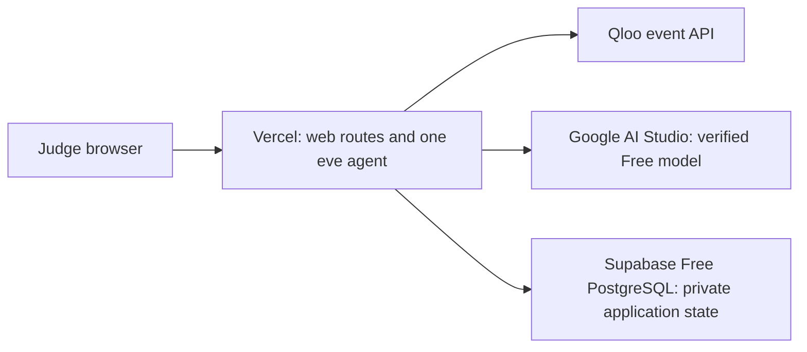

# CultureLoop resources, data, and deployment

Updated 2026-10-27. Budget: **free tiers only**. Google model/local eve and hosted Supabase schema/transaction checks pass. The entrant confirmed all three Free/Hobby plans; the Vercel project is created and linked. Shared/hosted eve execution remains pending. Follow [setup](SETUP.md) and [assistant verification](ASSISTANT_VERIFICATION.md).

## Resources to prepare

| Resource | What it supplies | Setup status / requirement |
| --- | --- | --- |
| Qloo event access | Entity identities and cultural evidence | Key issued; live search/catalog ranking verified privately |
| GitHub account/repository | Public source, issues, version history | [Source repository](https://github.com/aliirtaza58/cultureloop); initial source pushed October 18 |
| Vercel Hobby account/project | Public HTTPS web app and agent runtime | Entrant confirmed Hobby target; runtime/deployment allowances still need checking |
| Supabase Free PostgreSQL | Persistent rooms, listings, approvals, private caches | TLS/login, five RLS-protected tables, zero browser grants and transaction/rollback checks passed |
| Google AI Studio Free | Model inference for one bounded tool-calling agent | Entrant confirmed Free; model-list and live tool protocol passed; quota is finite |
| Devpost entry | Official submission and judge instructions | Entrant-owned; final submission remains an entrant action |
| Local Node/npm/Git | Development and verification | Verified locally; dependency versions pinned |
| A small consenting test group | Evidence about usefulness and usability | Aim for 5-8 exploratory testers; no recruitment messages authorized |

Built-in tooling can handle source and deployment work after target/account access is established. Do not request account passwords or API keys in chat.

Vercel lists a $0 Hobby plan. Its use and quotas must fit the entrant's account and plan conditions. [Pricing](https://vercel.com/pricing), [Hobby limits](https://vercel.com/docs/plans/hobby).

Supabase supplies PostgreSQL compatible with the existing SQL store. Use the dedicated prototype project, verified TLS and a transaction pooler; keep its Data API disabled and inspect grants/RLS before private data is loaded. Free projects have finite storage/connection allowances and can pause after inactivity. Actual account quota and judging availability remain checks. [Supabase pricing](https://supabase.com/pricing), [connections](https://supabase.com/docs/guides/database/connecting-to-postgres). Neon remains an alternative, not an additional required service.

Google calls go directly to the selected Gemini Developer API Free model. Verify the current model's eligibility, function calling and the entrant's actual quota. Free-tier request content may be used for product improvement, so preserve pseudonymous tool context. [Google pricing](https://ai.google.dev/gemini-api/docs/pricing), [rate limits](https://ai.google.dev/gemini-api/docs/rate-limits). Gateway remains an explicit alternative with its own finite free allowance; no automatic provider fallback or credit purchase.

## Where the data comes from

| Data | Source and acquisition | Where it belongs |
| --- | --- | --- |
| Cultural relationships and recommendation ranks | Qloo at runtime; no separate training corpus | Private server cache and displayed product evidence |
| Book title/author/optional ISBN | Member input; independently authored seed title list | Application catalog, with source noted |
| Canonical cultural entity IDs | Confirm Qloo search matches | Private application records; do not publish captured responses |
| Physical-copy ownership/condition/availability | Member declarations; synthetic examples clearly labeled | Listings table, separate from title identity |
| Cultural favorites | Up to 3 voluntary, confirmed inputs per member | App membership preferences; send entity signals to Qloo without identity |
| Acceptance/decline and inventory holds | Explicit app actions | Versioned persistent records |
| Optional descriptive book metadata | Open Library search/work/edition APIs | Small cache with source information |
| Tests | Independently authored synthetic inputs and expected constraints | Public test fixtures, never represented as live Qloo data |

Initial acquisition: author a list of 20-30 familiar book titles spanning several genres; resolve title and favorite identities using the key; inspect fixed-catalog results for five taste profiles. Do not build the app by collecting Qloo's graph. The matching model is a small live inventory plus current API evidence, not a downloaded taste database.

For a real room, members list physical books they offer. The demo's fictional ownership records are illustrative. Title-level taste evidence cannot establish a particular copy's condition, edition, availability, or desirability; members supply/check those facts.

The previously reviewed [Qloo guide](https://docs.qloo.com/reference/qloo-llm-hackathon-developer-guide) says no personal dataset is needed and allows private server caching. See [saved API notes](QLOO_API_REFERENCE.md). Public repositories must exclude captured Qloo response data.

Open Library is optional metadata enrichment, not cultural evidence. Its APIs require considerate use and caching, with 1 request/second for unidentified access and 3 for identified requests. Defer it if it adds a dependency without helping the core flow. [API policy](https://openlibrary.org/developers/api).

## Proposed hosted topology

Use the free provider-assigned HTTPS domain. No custom domain, VM, Docker server, GPU, paid analytics service, email provider, or external authentication subscription is required by the product plan.

eve supports a managed Vercel deployment and Next.js integration; the deployment also uses managed workflow/runtime services. A successful frontend build alone does not verify the agent. Confirm runtime health and a real tool-calling turn in the hosted environment. [eve deployment](https://github.com/vercel/eve/blob/main/docs/guides/deployment/vercel.mdx).

Record every service actually used. Include Workflow/Queues and any Sandbox consumption in the free-quota check. Use only necessary application-defined tools and avoid sandbox-dependent work when unnecessary; inspect actual framework behavior before claiming there is no sandbox use. [Workflow limits](https://vercel.com/docs/workflows/pricing), [Sandbox limits](https://vercel.com/docs/sandbox/pricing).

Application persistence belongs in Postgres. Hobby Workflow retention after run completion is short, currently one day; rooms and approvals must survive independently. [Workflow retention](https://vercel.com/docs/workflows/pricing).

## Setup and release sequence

1. Verify intended Vercel identity/project target. The GitHub repository already exists with an MIT license; preserve its history.
2. Verify free-only plan eligibility and resource quotas. Select an actually free-tier-eligible model supporting the required tools; do not accept a scaffold default blindly.
3. Preserve the existing app and pinned packages. Link the intended Vercel project before pulling environment values. Verify the dedicated Supabase target, Free plan, TLS and API isolation before schema/data operations; do not provision another service unnecessarily.
4. Configure server secrets in the host and local ignored environment. The committed .env.example is a proposed variable contract, not proof of a working integration. Check names/presence without printing values. Preserve local values before any environment-file replacement.
5. Run migrations against the intended development database, seed only labeled examples, and verify one browser-to-agent request. Keep preview and production data logically isolated; create a separate free branch/database if quota permits.
6. Deploy an early preview. Test health, model auth, Qloo auth, database persistence, guest membership, and streaming from the actual host. Do not postpone this integration test until final polish.
7. Release the tested build to a stable public production URL. Ensure the production entry does not require hosting-team login or a private deployment bypass. Keep application-level member authorization intact.
8. From a fresh browser, complete create/join, books/interests, proposal, evidence, decline/withdrawal, repair, accept, reload, and export. Record URL, revision, actual commands/results, and known limitations in release verification evidence.
9. Submit the production URL and public source on Devpost. Keep normal public judging access working throughout judging; check provider usage manually and leave headroom. No recurring automation has been requested or created.

Direct Google authentication uses its server-only key in local ignored configuration and host secret settings. Project OIDC is available for an explicitly selected Gateway alternative. Credentials do not establish quota or a paid allowance. [eve authentication/deployment](https://github.com/vercel/eve/blob/main/docs/guides/deployment/vercel.mdx).

## Scaling within a zero-dollar budget

Scale the number of bounded rooms, not the size of a global exchange graph. At 6 members and 3 listings each, a room has at most 18 offered copies. Match canonical titles, then allocate actual copies.

- Rank the room's fixed catalog per taste profile. Aim for roughly one Insights query per member for initial ranking, subject to actual API behavior; lookup and repair add requests. Avoid one Qloo request per possible book-person edge.
- Cache by canonical interests, catalog, documented filters, and relevant policy/version. Show retrieval time and cache reuse. Recompute only when inputs change and deduplicate in-flight identical requests.
- Use pooled database connections, room-scoped indexes/queries, atomic holds, and idempotent acceptance routes. Process memory is not shared across server instances.
- Bound simultaneous provider calls, agent steps, tokens, retries, room creation, and repeated generation. Measure actual usage before setting public limits; preserve a complete normal judge journey.
- Start with server polling/event updates appropriate to the actual workflow; add another realtime/cache service only when measurement warrants it and a free allowance fits.
- Exercise 1, 5, then 10 concurrent representative sessions against controlled synthetic/provider adapters before spending live quota. These are test targets, not verified capacity claims.
- Record model credit, Qloo quota, function/runtime events, database compute/storage, and errors. Avoid busy background polling that prevents database idle savings.

Free allowance exhaustion can stop new live generation. Show a clear retry/limit state and preserve valid existing proposals; do not silently fabricate responses or spend money. Unlimited traffic, uninterrupted free capacity, and production-scale service guarantees are not established by this plan.

## Free-only go-live checklist

- All linked services are on verified free plans; no paid trial, upgrade, purchased credits, or auto top-up.
- Current eligible model has passed one real tool-calling round trip; account credit and limits are known.
- Required eve managed services are available within their included allowance.
- Data persists across reloads/deploys, and participant decisions remain authorized and versioned.
- Production URL works in an incognito session without developer help.
- Normal public judge flow is usable within available quotas; actual live/cache provenance is visible.
- Secrets, private responses, real participant research, and database dumps are excluded from public source/artifacts.
- Public license/setup instructions and actual verification evidence exist.

Read current provider pages again when provisioning. If the proposed free account/runtime combination is unavailable, record the exact limitation and choose a genuinely free alternative; the budget constraint is not permission to upgrade.
